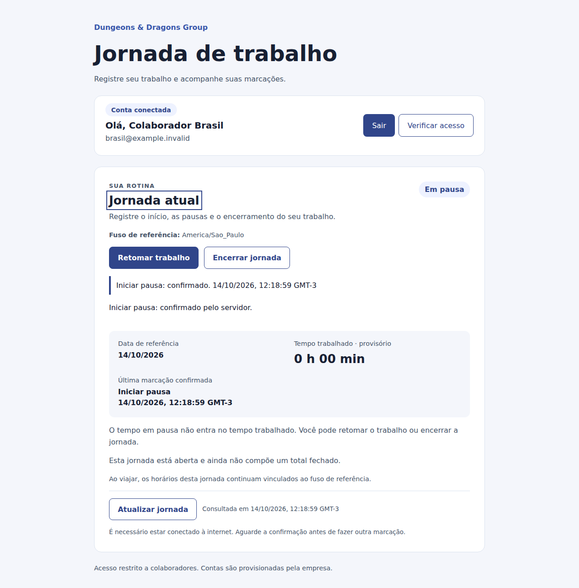

# Work Journey Platform

Aplicação web para registro e consulta de jornada de trabalho, desenvolvida para o desafio técnico da Dungeons & Dragons Group.

O cenário envolve pessoas trabalhando no Brasil e na Europa, inclusive de forma remota e durante viagens. Por isso, além do fluxo básico de ponto, a aplicação trata fuso horário, concorrência entre marcações e consulta por RH.



## Funcionalidades

- Login e logout com sessão e proteção CSRF.
- Registro de entrada, início de pausa, retorno e saída.
- Modalidade da marcação: escritório, remoto ou viagem.
- Jornada atual com estado, duração provisória e ações disponíveis.
- Histórico próprio por período e detalhe das marcações.
- Visão de RH com panorama dos colaboradores e consulta individual.
- Horários gravados em UTC, mantendo o fuso IANA informado pelo navegador.
- Proteção contra requisições repetidas e concorrentes.
- Layout responsivo e navegação por teclado.

O consolidado mensal e a regularização de marcações esquecidas ficaram fora desta primeira versão. Preferi entregar o fluxo principal com regras e integridade bem definidas, deixando essas extensões como próximos passos.

## Stack

| Camada | Tecnologia |
|---|---|
| Frontend | Angular 22, TypeScript e SCSS |
| Backend | Java 17, Spring Boot e Spring Security |
| Persistência | SQL Server 2022, JPA/Hibernate e Flyway |
| Testes | JUnit, Vitest e Playwright |
| CI | GitHub Actions |

Angular e SQL Server seguem o contexto do desafio. Escolhi Java no backend por ser a linguagem em que consigo demonstrar melhor modelagem, segurança e testes. Em um produto já integrado ao ecossistema Microsoft, ASP.NET seria uma alternativa natural; a separação entre frontend, domínio e persistência permite essa troca sem redesenhar a experiência.

## Decisões principais

- O servidor define a identidade e o instante de cada marcação.
- Os instantes são persistidos em UTC; o fuso IANA é armazenado separadamente para explicar registros feitos durante viagens.
- A data da jornada é calculada no fuso de referência do colaborador e não muda com o fuso de visualização.
- Uma chave de idempotência evita duplicar eventos após timeout ou repetição de uma requisição.
- Marcações do mesmo colaborador são serializadas no banco; constraints e versionamento protegem o estado entre dispositivos.
- Colaboradores consultam somente os próprios registros. A leitura do RH exige permissão específica revalidada no servidor.
- Flyway é a fonte de verdade do banco; o Hibernate apenas valida o schema.

Detalhes e trade-offs estão em [Arquitetura](docs/arquitetura.md), [Requisitos](docs/requisitos.md) e [API de jornada](docs/api-jornada.md).

## Como executar

### Pré-requisitos

- JDK 17
- Node 24 (versão exata em `.nvmrc`)
- Docker com Compose
- Git

Os scripts de desenvolvimento usam Bash em macOS ou Linux. As senhas incluídas neles são fictícias e servem somente para o ambiente local.

### 1. Clonar o projeto

```bash
git clone https://github.com/Juliarezende521/Plataforma-Jornada-Trabalho.git
cd Plataforma-Jornada-Trabalho
```

### 2. Preparar o banco

```bash
./scripts/local/setup.sh
```

Esse comando inicia o SQL Server com Docker Compose, aguarda o banco ficar disponível, cria os usuários, aplica as migrations e concede as permissões da aplicação. Ele pode ser executado novamente sem recriar o banco.

Se a porta `1433` já estiver em uso, escolha outra porta nos comandos de setup e backend:

```bash
SQLSERVER_PORT=14330 ./scripts/local/setup.sh
SQLSERVER_PORT=14330 ./scripts/local/backend.sh
```

### 3. Iniciar a aplicação

Terminal 1:

```bash
./scripts/local/backend.sh
```

Terminal 2:

```bash
./scripts/local/frontend.sh
```

Abra `https://localhost:4200`. O navegador pode pedir confirmação para o certificado local de desenvolvimento.

Para encerrar o banco depois da avaliação:

```bash
docker compose down
```

Use `docker compose down -v` somente se também quiser apagar os dados locais.

### Contas de avaliação

As contas usam a senha definida em `EVALUATION_PASSWORD` na primeira inicialização:

| Conta | Perfil |
|---|---|
| `brasil@example.invalid` | Colaborador em São Paulo |
| `europa@example.invalid` | Colaborador em Amsterdã |
| `rh@example.invalid` | Consulta do RH |

## Testes

```bash
(cd backend && ./mvnw verify)
(cd frontend && npm ci && npm run build && npm test -- --watch=false)
```

A suíte padrão do backend não inicia o SQL Server. Os testes de migration, persistência e concorrência com banco real, junto dos fluxos Playwright em HTTPS, são executados pelo workflow [SQL Server e navegador](.github/workflows/auth-integration.yml).

## Estrutura

```text
backend/               API, domínio, segurança e migrations
frontend/              aplicação Angular e testes de interface
docs/                  requisitos, arquitetura e evidências
scripts/ci/            validação integrada com SQL Server e navegador
.github/workflows/     pipelines de build e integração
```

## Limitações conhecidas

- Não há cadastro público nem recuperação de senha; as contas são provisionadas para avaliação.
- Não há correção retroativa ou aprovação de ajustes de jornada.
- Não há consolidado mensal, cálculo de horas extras ou integração com folha.
- A localização é declarada pelo fuso e pela modalidade; a aplicação não usa geolocalização.
- A execução local do SQL Server depende de host compatível com a imagem oficial. Em máquinas ARM pode ser necessário usar uma instância externa.
- O perfil de avaliação e as credenciais de exemplo não representam uma configuração de produção.

## Próximos passos

1. Fluxo auditável para solicitar e aprovar correções.
2. Consolidado por período para apoiar o fechamento mensal.
3. Integração com o provedor de identidade da empresa.
4. Validação em dispositivos físicos com pessoas de RH e colaboradores.
