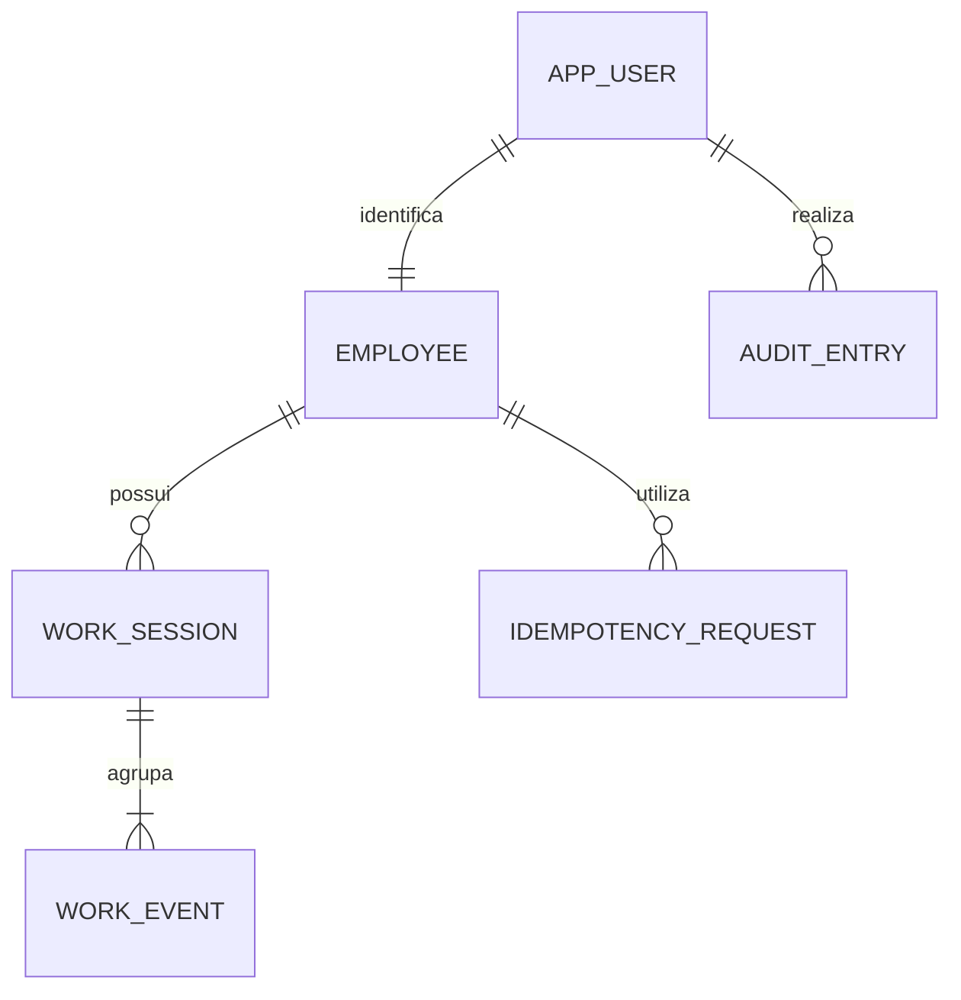

# Arquitetura, modelo e decisões técnicas

Status: proposta para implementação. A documentação inicial descreve as regras de negócio; este documento detalha sua tradução técnica.

## ADR01 — Stack e organização

Decisão: Java/Spring Boot, Angular/TypeScript, SQL Server, Spring Data JPA/Hibernate, Spring Security e Flyway. Monólito em um único backend, organizado por funcionalidade. Frontend e API na mesma origem no ambiente publicado; proxy no desenvolvimento.

Motivo: Java aproveita a experiência da desenvolvedora; Angular segue o direcionamento; SQL Server combina familiaridade acadêmica e informação adicional sobre a empresa. Trade-off: o backend difere do ecossistema Microsoft predominante. Não há necessidade demonstrada de microserviços, filas ou infraestrutura distribuída nesta versão.

Controller valida DTO e chama serviço; serviço aplica autorização e regra transacional; repository acessa dados; entidades não são retornadas diretamente. O frontend apresenta estado e envia comandos; o servidor é a autoridade para estado, tempo, identidade e cálculo.

## ADR02 — Sessão e segurança

Decisão: sessão no servidor, identificada por cookie; sem JWT persistido no navegador. Spring Security controla autenticação, contexto, troca do identificador de sessão e logout. Senhas com PasswordEncoder adaptativo; nunca texto puro ou hash simples.

Proteção CSRF nas mutações. Cookie de sessão HttpOnly, Secure em HTTPS e SameSite configurado. Token CSRF integrado ao Angular é separado do cookie de sessão e pode ser legível por JavaScript. Obter/renovar token antes das mutações e após mudanças de autenticação. Respostas de API 401/403 em JSON, sem redirecionamento HTML.

Limitar tentativas de login e tamanho de payload; não revelar se um email existe. Autorizar os recursos no servidor, não só pelos guards do Angular. Não confiar em UserId, EmployeeId, perfil ou timestamp enviados pelo cliente. Sessões em memória atendem a uma instância no MVP; reinício exige novo login. Escala horizontal exigiria revisão, não implementada.

## ADR03 — Fonte temporal

Decisão: Instant UTC no domínio, Clock injetado, ZoneId IANA para conversão, LocalDate para data de referência e Duration para cálculo. Jornada congela seu fuso e data de início. Viajar altera a visualização; alterar cadastro não reclassifica registros antigos.

No SQL Server: datetimeoffset(7) normalizado para +00:00 e identificador IANA separado. Verificar conversão do driver/Hibernate em integração; utilizar OffsetDateTime UTC na fronteira quando necessário. Precisão de armazenamento: 100 ns, com normalização definida e testada. Converter para o fuso na aplicação, evitando depender de equivalência entre IANA e Windows. Não utilizar rowversion como data/hora.

Trade-off: todo o trabalho de uma jornada que atravessa o mês fica no mês de sua data inicial. É um resumo operacional; um fechamento legal por intervalos exigiria outra regra. Pausas são descontadas neste MVP; não presumir política remuneratória por país.

## Modelo relacional proposto

| Tabela | Campos principais | Restrições |
|---|---|---|
| app_user | id UUID, email normalizado, password_hash, active | PK; email único; hash nunca exposto |
| employee | id UUID, user_id, name, reference_time_zone_id, manager_id opcional P1 | user_id único e FK; manager FK se implementado |
| work_session | id UUID, employee_id, work_date, reference_time_zone_id, state, closed_at_utc, version bigint | FK; version não nulo; estado e encerramento coerentes |
| work_event | id UUID, work_session_id, event_type, occurred_at_utc, recorded_at_utc, sequence, author_user_id | FKs; tipo permitido; sequence positiva e única por jornada |
| idempotency_request | id UUID, employee_id, request_key, payload_hash, result_event_id | FK; chave única por colaborador; resultado do comando confirmado |
| audit_entry | id UUID, actor_user_id opcional, action, entity_id, recorded_at_utc, correlation_id | Dados mínimos; ausência de cookies, senhas e tokens |

V1 implementa app_user e employee com UUID/uniqueidentifier, comprimentos, nullability, unicidade e FK. DDL/mapeamento foram aprovados em SQL Server 2022 CU20, na CI 38090975052; manager_id e demais tabelas continuam propostas. Contrato de autenticação: [autenticacao.md](autenticacao.md). Evidências: [validacao-integrada.md](validacao-integrada.md).

Atualização de 13/10/2026: V2 para work_session/work_event está na PR #3, com decisões, testes e status em [persistencia-jornada.md](persistencia-jornada.md). Mapeamento JPA de jornada, idempotência, auditoria de regularizações e manager_id continuam pendentes; a tabela acima descreve o modelo geral proposto.

Jornada aberta: closed_at_utc nulo. Criar índice UNIQUE filtrado sobre employee_id WHERE closed_at_utc IS NULL. Adicionar CHECK que exija encerramento presente apenas em estado encerrado. Histórico indexado por employee_id/work_date, com ordenação estável também por id.

O banco assegura unicidade e integridade referencial; sequência temporal e transições são aplicadas pelo serviço e comprovadas por testes. Não prometer que todo o estado da máquina de jornada é garantido só por constraints.

## ADR04 — Transações, concorrência e idempotência

Um comando válido grava, na mesma transação, resultado idempotente, evento e estado/versão da jornada. @Version deve efetivamente incrementar em toda transição; inserir apenas um evento filho não pode contornar a proteção do agregado. Forçar alteração do estado/versão conforme o mapeamento e testar duas transições concorrentes.

Para abertura simultânea, índice único filtrado protege o colaborador mesmo sem jornada anterior. Para chaves repetidas, índice único da idempotência protege o resultado. Mesmo colaborador + chave + payload retorna o resultado confirmado; chave reutilizada com payload diferente retorna 409. Verificar o resultado idempotente antes de rejeitar pela nova situação da jornada. Uma colisão simultânea pode exigir rollback e nova consulta em outra transação; não continuar dentro de transação inválida.

Se houver timeout de resposta, a gravação pode ter ocorrido. O cliente deve consultar o recibo autenticado e, se necessário, repetir explicitamente com a mesma chave/payload. Gerar chave nova significa intenção de nova operação e não serve como recuperação automática. Chaves são preservadas no MVP; política de expiração dependeria de janela de repetição definida. Diário local mínimo preservado antes do envio, vínculo ao alvo da jornada, reautenticação, múltiplas abas e limitações seguem [requisitos.md](requisitos.md#recuperação-de-marcação-online--decisão-p0). Não armazenar credenciais nem enviar fila offline.

## ADR05 — Migrations e execução

Flyway é a fonte de evolução do banco; spring.jpa.hibernate.ddl-auto=validate. Sem update/create/create-drop para avaliação e sem baseline automático. Scripts já aplicados não são editados. Driver JDBC oficial Microsoft e dependências Flyway compatíveis serão fixados com as versões do projeto.

Separar usuário de migration com DDL e usuário de execução com DML mínimo. Não utilizar sa como conta da aplicação. TLS com certificado validado no ambiente publicado; aceitar certificado local apenas com configuração explícita e restrita ao desenvolvimento.

SQL Server Developer é destinado a desenvolvimento/teste. Verificar arquitetura da máquina: containers oficiais Linux são suportados em x86-64. Ambiente ARM deve permitir conexão a instância em host suportado; Testcontainers depende de ambiente Docker compatível e dos termos de licença aceitos. Oferecer modo documentado de testes com banco externo dedicado quando necessário; não substituir por H2 e afirmar equivalência.

## Contrato mínimo da API

### Regularização mínima P0 — arquitetura planejada

Adicionar autoridade específica de aprovador e vínculo de escopo provisionado no servidor; o papel EMPLOYEE existente não oferece essa autorização. Sem RF16 implícito, administração pública de contas ou autorização baseada em IDs/perfis enviados pelo navegador. Novo principal/seed deverão incluir permissões e testes, sem alterar a conclusão atual de autenticação apenas EMPLOYEE.

Persistir pedido de regularização e revisão efetiva separados de work_event original. Pedido referencia jornada, versão e autor; revisão aprovada referencia pedido único, instante efetivo UTC, valores anterior/novo e decisor. Instantes de pedido/decisão são do servidor; instante efetivo é proposta manual validada, nunca confundido com marcação online. Unicidade de pedido PENDING por jornada e de revisão por pedido, FKs, estado terminal e versão devem ser definidos na migration e comprovados em SQL Server real.

Aprovação revalida estado/versão e grava decisão, revisão, encerramento efetivo/versão e auditoria em uma transação; rejeição/cancelamento não encerram jornada. Saída online válida cancela pedido superado atomicamente. Idempotência é vinculada ao ator autenticado e operação; consultar resultado confirmado antes de validar novo estado. Concorrência entre decisões, marcação e cancelamento exige testes de estado final e rollback. Contratos HTTP específicos e limites ainda serão definidos antes de implementação; regra canônica em [requisitos.md](requisitos.md#regularização-mínima-de-saída-esquecida--decisão-p0).

| Operação | Entrada | Resposta |
|---|---|---|
| GET /api/auth/csrf | Nenhuma | Token para mutações; sem identidade secreta na resposta |
| POST /api/auth/login | Credenciais e CSRF, formato definido pelo fluxo Security | Sessão estabelecida ou erro genérico |
| POST /api/auth/logout | Sessão e CSRF | Sessão invalidada |
| POST /api/me/work-events | Tipo, expectedWorkSessionId (null para entrada) e header Idempotency-Key | Evento confirmado; novo registro 201; repetição retorna resposta original |
| GET /api/me/work-event-requests/{key} | Chave UUID e sessão autenticada | 200: recibo terminal próprio com resultado original; 404: sem recibo visível, não garante que a primeira requisição terminou; 401: reautenticar |
| GET /api/me/work-sessions/current | Sessão | Jornada atual ou representação vazia documentada |
| GET /api/me/work-sessions | from/to/page/size | Histórico próprio e resumo conforme contrato final |
| GET /api/me/work-sessions/{id} | ID e sessão | Detalhe próprio; 404 se inexistente ou alheio |

Filtros from/to são datas de referência inclusivas; limite inicial proposto: 366 dias. Página inicial 0, size padrão 20, máximo 100. Ordenar por work_date decrescente e id como desempate. Parâmetros inválidos: 400. Instantes ISO 8601 UTC. Duração total em unidade numérica documentada; apresentação em horas/minutos apenas no frontend. Congelar contrato após implementação e validar exemplos reais.

Erros com Problem Details e identificador de correlação, sem stack traces: 400 validação, 401 ausência/expiração da sessão, 403 permissão ou CSRF inválido, 404 recurso invisível, 409 transição/concorrência/chave incompatível, 429 limite de requisições quando configurado.

## Referências oficiais

- [Microsoft — datetimeoffset](https://learn.microsoft.com/en-us/sql/t-sql/data-types/datetimeoffset-transact-sql)
- [Microsoft — índices filtrados](https://learn.microsoft.com/en-us/sql/relational-databases/indexes/create-filtered-indexes)
- [Microsoft — containers SQL Server](https://learn.microsoft.com/en-us/sql/linux/quickstart-install-connect-docker)
- [Spring Security — CSRF](https://docs.spring.io/spring-security/reference/servlet/exploits/csrf.html)
- [Spring Boot — inicialização do banco](https://docs.spring.io/spring-boot/how-to/data-initialization.html)

As regras de negócio e prioridades são decisões propostas para o desafio, não prescrições dessas fontes.
