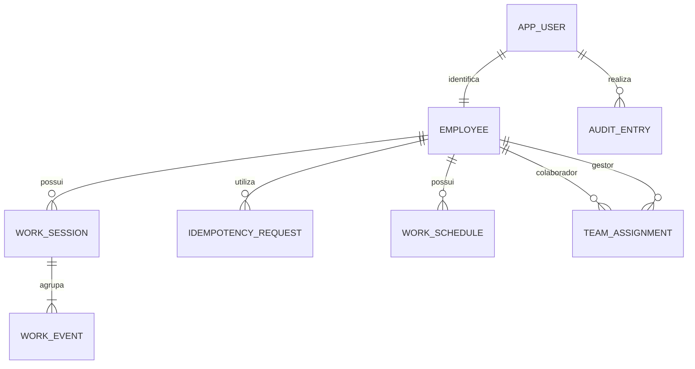

# Arquitetura, modelo e decisões técnicas

Status: arquitetura da versão atual. Itens futuros estão identificados explicitamente.

## ADR01 — Stack e organização

Decisão: Java/Spring Boot, Angular/TypeScript, SQL Server, Spring Data JPA/Hibernate, Spring Security e Flyway. Monólito em um único backend, organizado por funcionalidade. Frontend e API na mesma origem no ambiente publicado; proxy no desenvolvimento.

Motivo: Java aproveita a experiência da desenvolvedora; Angular segue o direcionamento; SQL Server combina familiaridade acadêmica e informação adicional sobre a empresa. Trade-off: o backend difere do ecossistema Microsoft predominante. Não há necessidade demonstrada de microserviços, filas ou infraestrutura distribuída nesta versão.

Controller valida DTO e chama serviço; serviço aplica autorização e regra transacional; repository acessa dados; entidades não são retornadas diretamente. O frontend apresenta estado e envia comandos; o servidor é a autoridade para estado, tempo, identidade e cálculo.

## ADR02 — Sessão e segurança

Decisão: sessão no servidor, identificada por cookie; sem JWT persistido no navegador. Spring Security controla autenticação, contexto, troca do identificador de sessão e logout. Senhas com PasswordEncoder adaptativo; nunca texto puro ou hash simples.

Proteção CSRF nas mutações. Cookie de sessão HttpOnly, Secure em HTTPS e SameSite configurado. Token CSRF integrado ao Angular é separado do cookie de sessão e pode ser legível por JavaScript. Obter/renovar token antes das mutações e após mudanças de autenticação. Respostas de API 401/403 em JSON, sem redirecionamento HTML.

Limitar tentativas de login e tamanho de payload; não revelar se um email existe. Autorizar os recursos no servidor, não só pelos guards do Angular. Não confiar em UserId, EmployeeId, perfil ou timestamp enviados pelo cliente. Sessões em memória atendem a uma instância no MVP; reinício exige novo login. Escala horizontal exigiria revisão, não implementada.

## ADR03 — Fonte temporal

Decisão: Instant UTC no domínio, Clock injetado, ZoneId IANA para conversão, LocalDate para data de referência e Duration para cálculo. Jornada congela seu fuso e data de início. Viajar altera a visualização; alterar cadastro não reclassifica registros antigos.

No SQL Server: datetimeoffset(7) normalizado para +00:00 e identificador IANA separado. Verificar conversão do driver/Hibernate em integração; utilizar OffsetDateTime UTC na fronteira quando necessário. Precisão de armazenamento: 100 ns, com normalização definida e testada. Converter para o fuso na aplicação, evitando depender de equivalência entre IANA e Windows. Não utilizar rowversion como data/hora.

Trade-off: todo o trabalho de uma jornada que atravessa o mês fica no mês de sua data inicial. É um resumo operacional; um fechamento legal por intervalos exigiria outra regra. Pausas são descontadas neste MVP; não presumir política remuneratória por país.

## Modelo relacional proposto

| Tabela | Campos principais | Restrições |
|---|---|---|
| app_user | id UUID, email normalizado, password_hash, active | PK; email único; hash nunca exposto |
| employee | id UUID, user_id, name, reference_time_zone_id | user_id único e FK |
| work_session | id UUID, employee_id, work_date, reference_time_zone_id, state, closed_at_utc, version bigint | FK; version não nulo; estado e encerramento coerentes |
| work_event | id UUID, work_session_id, event_type, occurred_at_utc, recorded_at_utc, sequence, author_user_id | FKs; tipo permitido; sequence positiva e única por jornada |
| idempotency_request | id UUID, employee_id, request_key, payload_hash, result_event_id | FK; chave única por colaborador; resultado do comando confirmado |
| work_adjustment_request | id UUID, jornada, colaborador, evento proposto, instante, motivo, estado, decisão e version | Eventos originais permanecem imutáveis; decisão terminal |
| audit_entry | id UUID, actor_user_id, action, entity_id, recorded_at_utc, details | Registro append-only das solicitações e decisões |
| work_schedule | id UUID, employee_id, effective_from, minutos por dia, autoria e criação | Uma versão por colaborador/data; registros imutáveis |
| team_assignment | id UUID, employee_id, manager_employee_id, effective_from, autoria e criação | Uma versão por colaborador/data; sem autoatribuição; registros imutáveis |
| country_work_policy | id UUID, país, vigência, referências semanal/diária, intervalo, tolerância, autoria e criação | Uma versão por país/data; parâmetros internos imutáveis |

As migrations V1–V16 implementam contas, colaboradores, jornadas, eventos, recibos idempotentes, permissão de leitura do RH, modalidade, solicitações auditáveis de ajuste, escalas e exceções versionadas, auditoria, contratos, fechamentos mensais, vínculos de equipe, políticas operacionais por país e o índice da busca de colaboradores.

Jornada aberta: closed_at_utc nulo. Criar índice UNIQUE filtrado sobre employee_id WHERE closed_at_utc IS NULL. Adicionar CHECK que exija encerramento presente apenas em estado encerrado. Histórico indexado por employee_id/work_date, com ordenação estável também por id.

O banco assegura unicidade e integridade referencial; sequência temporal e transições são aplicadas pelo serviço e comprovadas por testes. Não prometer que todo o estado da máquina de jornada é garantido só por constraints.

## ADR04 — Transações, concorrência e idempotência

Um comando válido grava, na mesma transação, resultado idempotente, evento e estado/versão da jornada. @Version deve efetivamente incrementar em toda transição; inserir apenas um evento filho não pode contornar a proteção do agregado. Forçar alteração do estado/versão conforme o mapeamento e testar duas transições concorrentes.

Para abertura simultânea, índice único filtrado protege o colaborador mesmo sem jornada anterior. Para chaves repetidas, índice único da idempotência protege o resultado. Mesmo colaborador + chave + payload retorna o resultado confirmado; chave reutilizada com payload diferente retorna 409. Verificar o resultado idempotente antes de rejeitar pela nova situação da jornada. Uma colisão simultânea pode exigir rollback e nova consulta em outra transação; não continuar dentro de transação inválida.

`PESSIMISTIC_WRITE` no colaborador ativo serializa comandos antes de verificar recibo e estado, junto ao `@Version` e às constraints. Conflitos de negócio geram recibo terminal na mesma transação; falha de banco causa rollback, sem repetição automática. A fonte temporal também verifica o último encerramento antes de uma nova entrada, evitando sobreposição se o relógio regredir.

Se houver timeout de resposta, a gravação pode ter ocorrido. O cliente consulta o recibo autenticado e, se necessário, repete explicitamente a mesma chave e o mesmo conteúdo. Gerar uma chave nova representa outra intenção. O diário local não armazena credenciais e não funciona como fila offline.

## ADR05 — Migrations e execução

Flyway é a fonte de evolução do banco; spring.jpa.hibernate.ddl-auto=validate. Sem update/create/create-drop para avaliação e sem baseline automático. Scripts já aplicados não são editados. Driver JDBC oficial Microsoft e dependências Flyway compatíveis serão fixados com as versões do projeto.

Separar usuário de migration com DDL e usuário de execução com DML mínimo. Não utilizar sa como conta da aplicação. TLS com certificado validado no ambiente publicado; aceitar certificado local apenas com configuração explícita e restrita ao desenvolvimento.

SQL Server Developer é destinado a desenvolvimento/teste. Verificar arquitetura da máquina: containers oficiais Linux são suportados em x86-64. Ambiente ARM deve permitir conexão a instância em host suportado; Testcontainers depende de ambiente Docker compatível e dos termos de licença aceitos. Oferecer modo documentado de testes com banco externo dedicado quando necessário; não substituir por H2 e afirmar equivalência.

## Contrato mínimo da API

| Operação | Entrada | Resposta |
|---|---|---|
| GET /api/auth/csrf | Nenhuma | Token para mutações; sem identidade secreta na resposta |
| POST /api/auth/login | Credenciais e CSRF, formato definido pelo fluxo Security | Sessão estabelecida ou erro genérico |
| POST /api/auth/logout | Sessão e CSRF | Sessão invalidada |
| POST /api/me/work-events | Tipo, expectedWorkSessionId (null para entrada) e header Idempotency-Key | Evento confirmado; novo registro 201; repetição retorna resposta original |
| GET /api/me/work-event-requests/{key} | Chave UUID e sessão autenticada | 200: recibo terminal próprio com resultado original; 404: sem recibo visível, não garante que a primeira requisição terminou; 401: reautenticar |
| GET /api/me/work-sessions/current | Sessão | Jornada atual ou representação vazia documentada |
| GET /api/me/work-sessions | from/to/page/size | Histórico próprio paginado |
| GET /api/me/work-sessions/summary | from/to | Resumo efetivo do período, processado em lotes |
| GET /api/me/work-schedule | on opcional | Escala própria vigente na data |
| POST /api/hr/employees/{id}/work-schedules | Vigência e minutos dos sete dias | Nova versão imutável da escala |
| GET /api/me/work-sessions/{id} | ID e sessão | Detalhe próprio; 404 se inexistente ou alheio |
| POST /api/me/work-adjustments | Jornada, evento, instante proposto e justificativa | Solicitação pendente sem alterar o evento original |
| GET /api/me/work-adjustments | Jornada/página | Solicitações próprias paginadas |
| GET /api/hr/work-adjustments | Página | Fila paginada de solicitações pendentes |
| GET /api/hr/audit-entries | Página | Trilha cronológica das ações sensíveis, restrita ao RH |
| GET/POST /api/hr/employees/{id}/employment-contracts | Página ou versão | Histórico e criação auditável de contratos |
| GET/POST /api/hr/employees/{id}/monthly-closures | Competência ou página | Consulta, histórico e fechamento mensal auditável |
| GET/POST /api/hr/employees/{id}/manager-assignments | Página ou vínculo | Histórico e criação auditável do gestor vigente |
| GET /api/manager/team | Página | Subordinados diretos vigentes do gestor autenticado |
| GET /api/manager/employees/{id}/work-sessions | Período/página | Histórico de um subordinado direto, com revalidação do vínculo |
| GET/POST /api/manager/work-adjustments | Página ou decisão | Fila e decisão de ajustes limitadas à equipe direta vigente |
| GET /api/hr/employees/{id}/work-sessions/report | from/to | Resumo individual em CSV, com o mesmo cálculo em lotes da interface |
| POST /api/hr/work-adjustments/{id}/decision | Aprovar/rejeitar e observação | Decisão terminal e auditada pela fila global do RH |

Filtros `from` e `to` são datas de referência inclusivas, limitadas a 366 dias. A página inicial é 0; o tamanho padrão é 20 e o máximo é 100. A ordenação usa data e abertura decrescentes, com ID como desempate. Parâmetros inválidos retornam 400 e instantes usam ISO 8601 UTC.

Erros com Problem Details e identificador de correlação, sem stack traces: 400 validação, 401 ausência/expiração da sessão, 403 permissão ou CSRF inválido, 404 recurso invisível, 409 transição/concorrência/chave incompatível, 429 limite de requisições quando configurado.

## Referências oficiais

- [Microsoft — datetimeoffset](https://learn.microsoft.com/en-us/sql/t-sql/data-types/datetimeoffset-transact-sql)
- [Microsoft — índices filtrados](https://learn.microsoft.com/en-us/sql/relational-databases/indexes/create-filtered-indexes)
- [Microsoft — containers SQL Server](https://learn.microsoft.com/en-us/sql/linux/quickstart-install-connect-docker)
- [Spring Security — CSRF](https://docs.spring.io/spring-security/reference/servlet/exploits/csrf.html)
- [Spring Boot — inicialização do banco](https://docs.spring.io/spring-boot/how-to/data-initialization.html)

As regras de negócio e prioridades são decisões propostas para o desafio, não prescrições dessas fontes.

## Estado atual

POST de marcação, GET de recibo, jornada atual, histórico, detalhe, resumo efetivo, consultas do RH e do gestor, fechamento mensal e fluxo auditável de solicitação/decisão de ajustes estão implementados com DTOs explícitos. O vínculo de equipe é versionado por data, rejeita autoatribuição e ciclos, e cada consulta ou decisão do gestor revalida a relação vigente. RH e gestor compartilham a mesma regra transacional de decisão, mas as consultas do gestor já filtram e bloqueiam somente recursos da equipe direta. O detalhe expõe separadamente registros persistidos e a projeção efetiva, com duração recalculada. O resumo usa a mesma projeção, lê jornadas e ajustes em lotes e sinaliza jornadas ainda abertas. O fechamento persiste uma fotografia do resumo somente após validar escala completa, jornadas encerradas e ausência de ajustes pendentes. Uma correção aprovada que pause, retome ou encerre uma jornada aberta é anexada como novo evento, atualiza checkpoint e versão e registra decisão/auditoria na mesma transação; eventos anteriores não são reescritos. Consulta vazia retorna `session=null`; ações e duração da jornada aberta são provisórias. Falha transitória de banco retorna 503 sem recibo; demais falhas inesperadas retornam 500.
